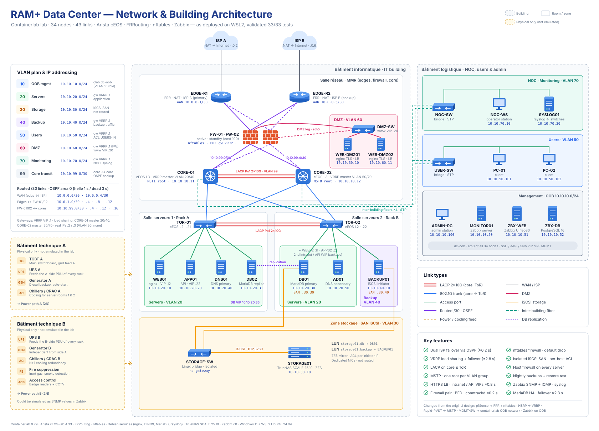

<div align="center">

# RAM+ Data Center — Containerlab Lab

**A complete data center (network + buildings) emulated with containers on a Windows laptop.**
No GNS3 VM, no nested virtualization — just WSL2, Docker and Containerlab.


*School project — ESPRIT, cybersecurity & cloud engineering*

[Quick start](#2-quick-start) · [First-time setup](#3-first-time-setup) · [Daily use](#4-daily-use) · [Architecture](#5-architecture) · [Troubleshooting](#7-troubleshooting) · [Team workflow](#8-team-workflow)

<br>



</div>

---

## Contents

1. [Overview](#1-overview)
2. [Quick start](#2-quick-start) — lab already installed
3. [First-time setup](#3-first-time-setup) — new team member, 11 steps
4. [Daily use](#4-daily-use) — commands, consoles, graphical view
5. [Architecture](#5-architecture) — mapping, addressing, features, design changes
6. [Repository layout](#6-repository-layout)
7. [Troubleshooting](#7-troubleshooting)
8. [Team workflow](#8-team-workflow)
9. [Status](#9-status)

---

## 1. Overview

| | |
|---|---|
| **Nodes** | 30 containers · 34 links · out-of-band management network `10.10.10.0/24` |
| **Internet edge** | 2 ISPs (NAT to the real Internet) · 2 FRR edge routers with NAT and port-forwards |
| **Security** | FW-01 = FRR (OSPF) + nftables, default-drop policy · DMZ (VLAN 60) with 2 web servers |
| **Core / access** | 2 Arista cEOS cores (VRRP, LACP, MSTP root, OSPF) · 2 cEOS top-of-rack switches |
| **Servers** | nginx intranet, Python API, BIND9 DNS, MariaDB, AD (IP/DNS), backup |
| **Storage** | **TrueNAS SCALE 25.10** (KVM virtual machine inside the lab): ZFS mirror, one zvol / iSCSI LUN per server, per-initiator ACL, isolated SAN |
| **Operations** | NOC with rsyslog from every switch · Zabbix 7 (SNMP + ICMP) on the OOB network |
| **Proof** | `scripts/tests.sh` — 20 automated checks, plus an ISP / VRRP failover demo |

```
Internet (ISP A, ISP B)
   │            │
EDGE-R1      EDGE-R2        FRRouting · NAT · port-forward to the DMZ
   └──── FW-01 ────┘        FRRouting (OSPF) + nftables policy ── DMZ (VLAN 60)
       │        │
   CORE-01 ══ CORE-02       Arista cEOS · VRRP · LACP · MSTP · OSPF
     │  ╲    ╱  │  ╲ ╲
   TOR-01 ══ TOR-02         Arista cEOS · dual-homed · LACP
   Rack A     Rack B        + fibers to the logistics building (NOC, users)
                 │
            STORAGE-SW ── STORAGE01 (TrueNAS SCALE · iSCSI)
```

---

## 2. Quick start

Already installed? From the Ubuntu terminal:

```bash
cd ~/projects/mini-dc-lab
git pull
./deploy.sh                           # 5–8 min — never press Ctrl+C
./scripts/tests.sh                    # expect: Result: 20 passed, 0 failed
python3 scripts/zabbix-add-hosts.py   # Zabbix: http://localhost:8080 (Admin / zabbix)
```

TrueNAS (storage01) needs 2–4 min after the deploy to boot — if the 3 iSCSI tests fail, wait and run the tests again.
Its configuration is kept on its virtual disks between deploys.

When you are done:

```bash
containerlab destroy -t mini-dc.clab.yml --cleanup
```

> [!IMPORTANT]
> Run the destroy command **before** shutting down Windows or running `wsl --shutdown`.
> The virtual cables between containers do not survive a WSL restart.

---

## 3. First-time setup

### What you need

| | |
|---|---|
| **OS** | Windows 11 (Home is fine), **virtualization enabled in BIOS/UEFI** (TrueNAS runs under KVM inside WSL) |
| **RAM** | **32 GB recommended** — WSL gets 24 GB (4 × cEOS ≈ 5–6 GB, TrueNAS VM 8 GB, Zabbix ≈ 1 GB). 16 GB laptops: see step 1 |
| **Disk** | ~20 GB free (images, TrueNAS ISO and virtual disks) |
| **Accounts** | GitHub (invited to this repo) · free **arista.com** account for the cEOS image |
| **Time** | ~1 h the first time (downloads and image builds), then 5–8 min per deploy |

**Team versions:** WSL2 + Ubuntu 24.04 · Docker Engine 27.x (*not* Docker Desktop) · Containerlab 0.79.0 · Arista cEOS-lab 4.33.10M · TrueNAS SCALE 25.10.7

> [!NOTE]
> Commands marked **PowerShell** run on Windows. Everything else runs in the **Ubuntu** terminal
> (Windows Terminal → ˅ → Ubuntu-24.04). Do the steps in order.

| Step | What | Time |
|:---:|---|:---:|
| 1 | [Install WSL2 + Ubuntu 24.04](#step-1--install-wsl2-and-ubuntu-2404) | 10 min |
| 2 | [Install Docker Engine](#step-2--install-docker-engine) | 5 min |
| 3 | [Install Containerlab](#step-3--install-containerlab) | 3 min |
| 4 | [Connect Git to GitHub](#step-4--connect-git-to-github) | 3 min |
| 5 | [Clone the repo](#step-5--clone-the-repo) | 1 min |
| 6 | [Get the cEOS image and the TrueNAS ISO](#step-6--get-the-ceos-image-and-the-truenas-iso) | 15 min |
| 7 | [Build the lab images](#step-7--build-the-lab-images) | 5–10 min |
| 8 | [Deploy the lab](#step-8--deploy-the-lab) | 5–8 min |
| 9 | [Install and configure TrueNAS](#step-9--install-and-configure-truenas-first-time-only) | 20 min |
| 10 | [Check it works](#step-10--check-it-works) | 2 min |
| 11 | [Open the graphical view](#step-11--open-the-graphical-view) | 5 min |
| 12 | [Stop the lab](#step-12--stop-the-lab) | 1 min |

---

### Step 1 — Install WSL2 and Ubuntu 24.04

**PowerShell (as Administrator):**

```powershell
wsl --install -d Ubuntu-24.04
```

Reboot if asked, open **Ubuntu-24.04** from the Start menu and create your Linux user. Then:

```powershell
wsl --update
wsl -l -v          # VERSION column must say 2
```

Give WSL enough memory — create `C:\Users\<you>\.wslconfig`:

```ini
[wsl2]
memory=24GB
processors=6
swap=4GB
```

Apply it with `wsl --shutdown` (PowerShell) and reopen Ubuntu.

> [!TIP]
> **16 GB laptop?** Use `memory=12GB`, comment out the `zbx-db`, `monitor01` and `zbx-web` nodes in
> `mini-dc.clab.yml` (saves ~1 GB) and give TrueNAS 4 GB: add `env: {TRUENAS_RAM: "4096"}` to `storage01`.

✅ **Check** — systemd must be running (Docker needs it) and KVM must exist (TrueNAS needs it):

```bash
ps -p 1 -o comm=      # systemd
ls /dev/kvm           # /dev/kvm
```

If it prints `init`: `printf '[boot]\nsystemd=true\n' | sudo tee /etc/wsl.conf`, then `wsl --shutdown` and reopen Ubuntu.

---

### Step 2 — Install Docker Engine

Inside Ubuntu, from Docker's official repository (what the lab is tested with):

```bash
sudo apt-get update && sudo apt-get install -y ca-certificates curl git
sudo install -m 0755 -d /etc/apt/keyrings
sudo curl -fsSL https://download.docker.com/linux/ubuntu/gpg -o /etc/apt/keyrings/docker.asc
sudo chmod a+r /etc/apt/keyrings/docker.asc
echo "deb [arch=$(dpkg --print-architecture) signed-by=/etc/apt/keyrings/docker.asc] https://download.docker.com/linux/ubuntu $(. /etc/os-release && echo "$VERSION_CODENAME") stable" | sudo tee /etc/apt/sources.list.d/docker.list > /dev/null
sudo apt-get update
sudo apt-get install -y docker-ce docker-ce-cli containerd.io docker-buildx-plugin docker-compose-plugin
sudo usermod -aG docker $USER
```

> [!WARNING]
> **Docker Desktop installed on Windows?** Open *Settings → Resources → WSL integration* and **untick both**
> "Enable integration with my default WSL distro" **and** the Ubuntu-24.04 toggle, then *Apply & restart*.
> Otherwise Docker Desktop takes over Ubuntu's Docker socket and the deploy hangs for 15+ minutes.

---

### Step 3 — Install Containerlab

```bash
bash -c "$(curl -sL https://get.containerlab.dev)"
sudo usermod -aG clab_admins $USER
```

The new groups only apply to new sessions: close Ubuntu, run `wsl --terminate Ubuntu-24.04` in
**PowerShell**, and reopen Ubuntu.

✅ **Check:**

```bash
groups                               # lists docker and clab_admins
docker run --rm hello-world          # "Hello from Docker!"
docker info --format '{{.Name}}'     # your PC name — NOT docker-desktop
containerlab version                 # 0.79.x or newer
```

From now on, run `containerlab` **without sudo**.

---

### Step 4 — Connect Git to GitHub

```bash
git config --global user.name "Your Name"
git config --global user.email "you@example.com"
ssh-keygen -t ed25519 -C "$(whoami)@wsl"      # press Enter 3 times
cat ~/.ssh/id_ed25519.pub
```

Paste the printed line into <https://github.com/settings/ssh/new> (type: *Authentication Key*).

✅ **Check:**

```bash
ssh -T git@github.com      # "Hi <username>! You've successfully authenticated"
```

---

### Step 5 — Clone the repo

```bash
mkdir -p ~/projects && cd ~/projects
git clone git@github.com:Givemeboga/mini-dc-lab.git
cd mini-dc-lab
```

> [!CAUTION]
> Always clone under `~/projects/...` (Linux filesystem). A clone under `/mnt/c/...` is very slow
> and breaks script permissions and line endings.

---

### Step 6 — Get the cEOS image and the TrueNAS ISO

The image is licensed by Arista, so it is **not** in the repo — each member downloads their own.

1. Log in on <https://www.arista.com> → **Support → Software Download**.
2. **EOS → Active Releases → 4.33 → EOS-4.33.10M → cEOS-lab** → `cEOS64-lab-4.33.10M.tar.xz` (~800 MB).
3. Import it (adapt the Windows user name):

```bash
cp /mnt/c/Users/<you>/Downloads/cEOS64-lab-4.33.10M.tar.xz ~/
docker import ~/cEOS64-lab-4.33.10M.tar.xz ceos:latest
rm ~/cEOS64-lab-4.33.10M.tar.xz      # optional, frees 800 MB
```

✅ **Check** — `docker images ceos` shows `ceos  latest  ~2.6GB`. The tag **must** be `ceos:latest`.

Then download the TrueNAS SCALE ISO (2.3 GB) into `truenas/` and verify it:

```bash
mkdir -p truenas && cd truenas
U=https://download.sys.truenas.net/TrueNAS-SCALE-Goldeye/25.10.7
curl -fLO $U/TrueNAS-SCALE-25.10.7.iso -fLO $U/TrueNAS-SCALE-25.10.7.iso.sha256
echo "$(cat TrueNAS-SCALE-25.10.7.iso.sha256)  TrueNAS-SCALE-25.10.7.iso" | sha256sum -c -   # ...: OK
cd ..
```

`truenas/` is in `.gitignore`: the ISO and the VM disks never go to GitHub.

---

### Step 7 — Build the lab images

```bash
./setup.sh
```

What it does:
- raises the kernel *inotify* limits (asks your sudo password once — several cEOS won't boot without it);
- builds `dc-router` (FRR + nftables), `dc-host` (Debian services) and `dc-truenas` (QEMU for the TrueNAS VM);
- checks `ceos:latest` and pre-pulls the Zabbix / PostgreSQL images.

✅ **Check** — it ends with `Ready. Deploy with: ./deploy.sh`.

---

### Step 8 — Deploy the lab

```bash
./deploy.sh
```

> [!CAUTION]
> **Never press Ctrl+C in this window** — it cancels the deploy and destroys the lab.
> The output stops for several minutes while the 4 Arista switches boot one after another. That is normal.
> `[deploy.sh] tor-01 booted into rescue mode -> continuing the boot` is also normal: the script fixes it.

Watch progress from a **second** Ubuntu tab:

```bash
watch -n5 'docker ps --format "table {{.Names}}\t{{.Status}}" | grep clab-mini-dc'
```

✅ **Check** — the deploy prints a table of 30 nodes and `Deployed. Wait ~30 s ...`.
If it says *"An old copy of the lab exists"* (after a reboot), answer `y`. If it says `Deploy FAILED`, read the ERROR above it.

---

### Step 9 — Install and configure TrueNAS (first time only)

`storage01` runs **TrueNAS SCALE** as a virtual machine. On the first deploy its disk is empty, so it boots the installer.

1. Open the VM console in your Windows browser: **<http://localhost:6080/vnc_lite.html?scale=true>** and click inside it.
2. **`1 Install/Upgrade`** → tick only **`vda` (32 GiB)** with Space → Enter → **Yes**.
   Do **not** tick `vdb` / `vdc` (20 GiB): they become the ZFS pool.
3. **`1 Administrative user (truenas_admin)`** → choose a password (lab default: `truenas`) → keep the other defaults.
4. "Installation succeeded" → **`3 Reboot System`**. After 2–4 min the console shows *Console setup* with options 1–10.
5. Configure it (it asks for the password if it is not `truenas`):

```bash
python3 scripts/truenas-setup.py
```

It sets the SAN address `10.10.30.10/24`, creates the ZFS mirror pool `tank`, the zvols `tank/db` (10 GiB) and
`tank/backup` (4 GiB), and the iSCSI targets `iqn.2026-09.lab.dc:storage01.db` (only db01) and `...:storage01.backup`
(only backup01). Safe to run again.

✅ **Check** — it ends with `Done.` Web UI: **<https://localhost:8443>** (`truenas_admin`, accept the self-signed certificate).

> [!NOTE]
> The installed TrueNAS and its configuration live in `truenas/*.qcow2` and survive destroy / deploy.
> You only do this step once per machine.

---

### Step 10 — Check it works

Wait ~30 s for OSPF and spanning tree to converge, then:

```bash
./scripts/tests.sh
```

✅ **Check** — last line: **`Result: 20 passed, 0 failed`**.
A test failed? Wait a minute and run it again, then see [Troubleshooting](#7-troubleshooting).

Register the devices in Zabbix (needed after **every** deploy), then open <http://localhost:8080>
in your Windows browser (`Admin` / `zabbix`):

```bash
python3 scripts/zabbix-add-hosts.py
```

Optional — failover demo (cuts ISP A and the VRRP master for a few seconds, then restores them):

```bash
./scripts/tests.sh failover          # ≈0.2 s loss for ISP, ≈2.8 s for VRRP
```

---

### Step 11 — Open the graphical view

1. Install **VS Code** on Windows with the extensions **WSL** (Microsoft) and **Containerlab** (srl-labs).
2. In Ubuntu, from the lab folder: `code .`
3. Containerlab icon in the sidebar → right-click `mini-dc` → **Graph (TopoViewer)**.
4. Switch VS Code to a light theme (**Ctrl+K Ctrl+T → Light Modern**) — the layout uses a white canvas.

Right-click a node for SSH / console, right-click a link for a Wireshark capture.
You should see this layout ([screenshot](docs/topoviewer.png)); interface names appear when you click a link.

---

### Step 12 — Stop the lab

```bash
containerlab destroy -t mini-dc.clab.yml --cleanup
```

Forgot before a reboot? Docker restarts the containers half-broken — run the destroy command, then `./deploy.sh` again.

🎉 **Setup done.** Next time, use the [Quick start](#2-quick-start).

---

## 4. Daily use

### Commands

| Command | What it does |
|---|---|
| `./deploy.sh` | Start the lab (5–8 min) |
| `./scripts/tests.sh` | 20 functional checks |
| `./scripts/tests.sh failover` | ISP + VRRP failover demo |
| `python3 scripts/zabbix-add-hosts.py` | Register all devices in Zabbix (after each deploy) |
| `python3 scripts/truenas-setup.py` | (Re)apply the TrueNAS pool / zvols / iSCSI configuration |
| `containerlab inspect -t mini-dc.clab.yml` | List nodes, state and management IPs |
| `containerlab destroy -t mini-dc.clab.yml --cleanup` | Stop and remove the lab |

### Consoles

| Device | How |
|---|---|
| cEOS (cores, ToRs) | `ssh admin@clab-mini-dc-core-01` (password `admin`) or `docker exec -it clab-mini-dc-core-01 Cli` |
| FRR routers / firewall | `docker exec -it clab-mini-dc-fw-01 vtysh` (routing) · `... sh` then `nft list ruleset` |
| Servers / PCs | `docker exec -it clab-mini-dc-web01 bash` |
| Zabbix | <http://localhost:8080> — `Admin` / `zabbix` |
| TrueNAS web UI | <https://localhost:8443> — `truenas_admin` |
| TrueNAS VM console | <http://localhost:6080/vnc_lite.html?scale=true> |

Useful checks:

```bash
docker exec clab-mini-dc-core-01 Cli -p 15 -c "show vrrp brief"
docker exec clab-mini-dc-core-01 Cli -p 15 -c "show ip ospf neighbor"
docker exec clab-mini-dc-fw-01 vtysh -c "show ip route"
```

---

## 5. Architecture

Two views of the same design:

| | |
|---|---|
| [`docs/architecture.svg`](docs/architecture.svg) | Architecture diagram (shown at the top), for the report |
| [`docs/topoviewer.png`](docs/topoviewer.png) | Screenshot of the running lab in VS Code TopoViewer |

<details>
<summary><b>Design → lab mapping</b></summary>

| Building / room | Device | Lab node | Image |
|---|---|---|---|
| Internet | ISP A / ISP B | `isp-a`, `isp-b` (NAT to the real Internet) | dc-router |
| Bât. informatique – MMR | EDGE-R1 / EDGE-R2 | `edge-r1`, `edge-r2` | dc-router (FRR) |
| | FW-01 | `fw-01` — OSPF + **nftables** (replaces pfSense) | dc-router |
| | CORE-01 / CORE-02 | `core-01`, `core-02` | **cEOS** |
| DMZ (VLAN 60) | DMZ-SW, WEB-DMZ01/02 | `dmz-sw` (Linux bridge), `web-dmz01/02` (nginx) | dc-host |
| Salle serveurs 1 | TOR-01, WEB01, APP01, DNS01 | `tor-01` (cEOS), `web01` (nginx), `app01` (Python API), `dns01` (BIND9) | |
| Salle serveurs 2 | TOR-02, DB01, AD01, BACKUP01 | `tor-02` (cEOS), `db01` (MariaDB), `ad01`, `backup01` | |
| Zone stockage | STORAGE-SW, STORAGE01 | `storage-sw` (bridge), `storage01` (**TrueNAS SCALE** VM under KVM) | dc-truenas |
| Bât. logistique | NOC, users | `noc-sw`, `user-sw` (bridges with STP, dual-homed), `noc-ws`, `syslog01`, `pc-01`, `pc-02` | |
| | Management | containerlab **OOB network 10.10.10.0/24** + `admin-pc` | |
| | Monitoring | `monitor01` (Zabbix server), `zbx-web`, `zbx-db` | official images |
| Bâtiments techniques A/B | UPS, generators, cooling | physical only — not emulated | |

</details>

<details>
<summary><b>Addressing</b></summary>

| VLAN / segment | Network | Gateway | Hosts |
|---|---|---|---|
| OOB management (VLAN 10 role) | 10.10.10.0/24 | .1 | cores .11/.12, ToRs .21/.22, edges .31/.32, fw .40, Zabbix .50–.52, bridges .71–.74, servers .100–.113 |
| 20 Servers | 10.10.20.0/24 | VRRP .1 (core-01 .2 master, core-02 .3) | web01 .10, app01 .20, db01 .30, dns01 .40, ad01 .50 |
| 30 Storage (not routed) | 10.10.30.0/24 | none | storage01 .10, db01 .30, backup01 .40 |
| 40 Backup | 10.10.40.0/24 | VRRP .1 | backup01 .10 |
| 50 Users | 10.10.50.0/24 | VRRP .1 | pc-01 .101, pc-02 .102 |
| 60 DMZ | 10.10.60.0/24 | fw-01 .1 | web-dmz01 .10, web-dmz02 .11 |
| 70 Monitoring / NOC | 10.10.70.0/24 | VRRP .1 | noc-ws .10, syslog01 .20 |
| 99 Core transit | 10.10.99.8/30 | — | core-01 .9, core-02 .10 |
| FW ↔ cores | 10.10.99.0/30, .4/30 | — | fw .1/.5, core-01 .2, core-02 .6 |
| Edges ↔ FW | 10.0.1.0/30, .4/30 | — | edge-r1 .1, edge-r2 .5, fw .2/.6 |
| WAN | 10.0.0.0/30, .4/30 | — | edge-r1 .1 ↔ isp-a .2, edge-r2 .5 ↔ isp-b .6 |

</details>

<details>
<summary><b>How each feature is implemented</b></summary>

- **Dual ISP + failover** — each edge has a static default to its ISP and injects it into OSPF
  (`default-information originate`, metric 10 on edge-r1, 20 on edge-r2). If an ISP link dies the
  route disappears and FW-01 switches to the other edge in ~3 s (OSPF hello 1 s / dead 3 s).
- **NAT** — edges masquerade outbound traffic; `edge-r1:80 → web-dmz01`, `edge-r2:80 → web-dmz02`.
  Port-forwarded traffic is also source-NATed so replies return through the same ISP.
- **Firewall** (`configs/nft/fw-01.nft`) — default drop. Inside → anywhere; Internet → DMZ web 80/443;
  DMZ → db01:3306 and dns01:53 only; DMZ → Internet 80/443/53; everything else counted + logged.
- **Core** — VRRP (HSRP equivalent) with core-01 master, LACP Port-Channel between cores and between
  ToRs, MSTP with core-01 as root, OSPF to the firewall + a transit VLAN 99 between cores as backup path,
  ACL `USERS-IN` so users only reach DNS / intranet / app (documented on the cores; cEOS-lab does not
  enforce SVI ACLs in software, so `db01` also runs a host firewall that only accepts MariaDB from
  the app servers and the DMZ — defense in depth).
- **SAN** — `storage01` is a container running **TrueNAS SCALE 25.10** as a KVM virtual machine
  (`scripts/init-truenas.sh`). Its SAN NIC is bridged onto the container's `eth1` cable to `storage-sw`, so TrueNAS
  owns `10.10.30.10`; a second NIC (QEMU user network) carries the web UI / API. `truenas-setup.py` configures it
  through the JSON-RPC WebSocket API: ZFS mirror pool `tank`, one zvol per server, one iSCSI target per server
  restricted by initiator network. `db01` and `backup01` use dedicated storage NICs; VLAN 30 has no gateway.
  Tested with `iscsi-ls` / `iscsi-readcapacity16` (userspace initiator, no kernel module needed).
- **OOB management** — cEOS management lives in a `MGMT` VRF; SSH, eAPI, SNMP and syslog run only there.
- **NOC** — switches send syslog to `syslog01` (`/var/log/remote/<host>.log`); Zabbix polls the switches
  over SNMP (community `dclab`) and pings every node.

</details>

<details>
<summary><b>Differences from the original design</b></summary>

| Original design | Lab | Why |
|---|---|---|
| pfSense | FRR + nftables | pfSense is a VM image (needs KVM) |
| HSRP | VRRP | HSRP is Cisco-only; VRRP is the open standard |
| Rapid-PVST | MSTP | cEOS default, interoperates with the Linux bridges |
| MGMT-SW (VLAN 10) | containerlab management network | it *is* a separate OOB network |
| MONITOR01 in VLAN 70 | Zabbix on the OOB network, `noc-ws` in VLAN 70 | monitoring usually sits on management |
| STORAGE-SW → ToRs | STORAGE-SW → servers' storage NICs | dedicated SAN, no loop, not routed |
| FW 10.10.99.254 | routed /30 links to each core | lets OSPF use both cores |
| AD01 (Samba AD) | IP + DNS only | optional; install `samba` inside ad01 if needed |

</details>

---

## 6. Repository layout

| Path | Purpose |
|---|---|
| `mini-dc.clab.yml` | Topology: 30 nodes, 34 links, management network `dc-oob` |
| `mini-dc.clab.yml.annotations.json` | TopoViewer layout (buildings, rooms, labels) — visual only |
| `.clab-icons/` | Custom TopoViewer icons |
| `configs/ceos/` | Arista startup configs — cores (L3, VRRP, MSTP root, OSPF), ToRs (L2) |
| `configs/frr/` | FRRouting configs for the edges, firewall and ISPs |
| `configs/nft/` | nftables — firewall policy, edge NAT / port-forwards, ISP NAT, db01 host firewall |
| `scripts/init-router.sh` | Boot script for ISPs, edges, firewall (sysctl, routes, MTU, nftables) |
| `scripts/init-bridge.sh` | Turns a container into a Linux-bridge switch (`stp` for dual-homed ones) |
| `scripts/init-host.sh` | Boot script for every server / PC — role chosen by hostname |
| `scripts/init-truenas.sh` | Boot script for storage01: bridges the SAN cable, starts the TrueNAS VM (QEMU/KVM) |
| `scripts/truenas-setup.py` | Configures TrueNAS (SAN IP, ZFS pool, zvols, iSCSI targets + ACL) via its API |
| `scripts/tests.sh` | 20 functional checks · `failover` demo |
| `scripts/zabbix-add-hosts.py` | Registers all devices in Zabbix through its API |
| `deploy.sh` | `containerlab deploy` + watcher that fixes cEOS rescue mode |
| `setup.sh` | One-time: kernel limits, builds `dc-router` / `dc-host` / `dc-truenas`, pulls Zabbix images |
| `images/` | Dockerfiles for `dc-router`, `dc-host` and `dc-truenas` |
| `truenas/` | TrueNAS ISO and VM disks (local only, not in git) |
| `docs/architecture.svg` | Architecture diagram |
| `docs/topoviewer.png` | Screenshot of the live lab in TopoViewer |
| `CLAUDE.md` | Notes for the Claude Code assistant: environment, commands, lessons learned |

---

## 7. Troubleshooting

**Install / Docker**

| Symptom | Fix |
|---|---|
| `docker: permission denied` | `sudo usermod -aG docker $USER`, then `wsl --terminate Ubuntu-24.04` and reopen |
| Deploy hangs 15+ min at "Running postdeploy actions", `docker ps` shows no lab | Docker Desktop took over the socket — `docker info --format '{{.Name}}'` says `docker-desktop`. In Docker Desktop → *Settings → Resources → WSL integration*, untick **"Enable integration with my default WSL distro"** and the Ubuntu toggle, then `wsl --shutdown` |
| Not enough RAM | Comment out `zbx-*` and `monitor01`, or raise `memory=` in `%UserProfile%\.wslconfig` |

**Deploy / switches**

| Symptom | Fix |
|---|---|
| Deploy silent for minutes | Normal while cEOS boots; `deploy.sh` also fixes a switch stuck in *rescue mode* |
| A switch never gets `Uptime` | `docker logs --tail 10 clab-mini-dc-tor-01` → if it says *rescue mode*: `docker exec clab-mini-dc-tor-01 systemctl default --no-block` |
| cEOS fails to boot with several switches | inotify limits too low — `setup.sh` raises them (`fs.inotify.max_user_instances=8192`) |
| Lab half-dead after a reboot / `wsl --shutdown` | Links don't survive a WSL restart: run `./deploy.sh` and answer `y` to destroy the old copy |

**Network / services**

| Symptom | Fix |
|---|---|
| OSPF core ↔ fw-01 stuck in EXCH START | MTU: `docker exec clab-mini-dc-fw-01 ip link set eth3 mtu 1500` (same for eth4) |
| Hosts can't reach the Internet | Check `docker exec clab-mini-dc-fw-01 vtysh -c "show ip route"` has a default route |
| noc-sw / user-sw no traffic for ~30 s | Spanning tree converging with the Linux bridges — wait |
| Zabbix page not loading | Wait 1–2 min after deploy (database initialisation) |

**TrueNAS / storage**

| Symptom | Fix |
|---|---|
| The 3 iSCSI tests fail right after a deploy | TrueNAS is still booting: check the console, wait 2–4 min, run the tests again |
| VM console page stays black / spinning | Use the lite page: <http://localhost:6080/vnc_lite.html?scale=true> |
| `truenas-setup.py`: "Login refused" | Wrong password; forgotten? console option **4) Change local administrator password** |
| storage01 boots the installer again | `truenas/boot.qcow2` was deleted or is empty: reinstall (step 9) |
| TrueNAS slow / out of memory | `free -g` in WSL must show ~23 GB (`memory=24GB`); lower `TRUENAS_RAM` on 16 GB laptops |

---

## 8. Team workflow

New here? Start with [First-time setup](#3-first-time-setup).

1. **Update** — `git pull` on `main` before you start.
2. **Branch** — one branch per task: `git switch -c feature/<topic>`.
3. **Test** — `./scripts/tests.sh` must say `20 passed`.
4. **Push** — `git push -u origin feature/<topic>`, then open a pull request and paste the test result.
5. **Review & merge** — no direct pushes to `main`.

> [!NOTE]
> `mini-dc.clab.yml.annotations.json` (the TopoViewer layout) is rewritten whenever someone moves things
> in the graph — agree on one person for layout changes to avoid merge conflicts.

**Not versioned** (see `.gitignore`): `clab-mini-dc/` (generated at every deploy, contains TLS keys),
logs, layout backups and the cEOS image. Never commit the cEOS `.tar.xz`.

---

## 9. Status

Validated on Windows 11 Home + WSL2 (Ubuntu 24.04, 32 GB RAM, cEOS 4.33.10M): VRRP, LACP, MSTP,
OSPF (cores + firewall), ISP failover, NAT / port-forwards, firewall policy, DNS, MariaDB from the DMZ,
iSCSI on TrueNAS SCALE 25.10 with per-server ACL, storage isolation, syslog — **20/20 tests passing**.

Measured failover: ISP ≈ 0.2 s · VRRP gateway ≈ 2.8 s.
